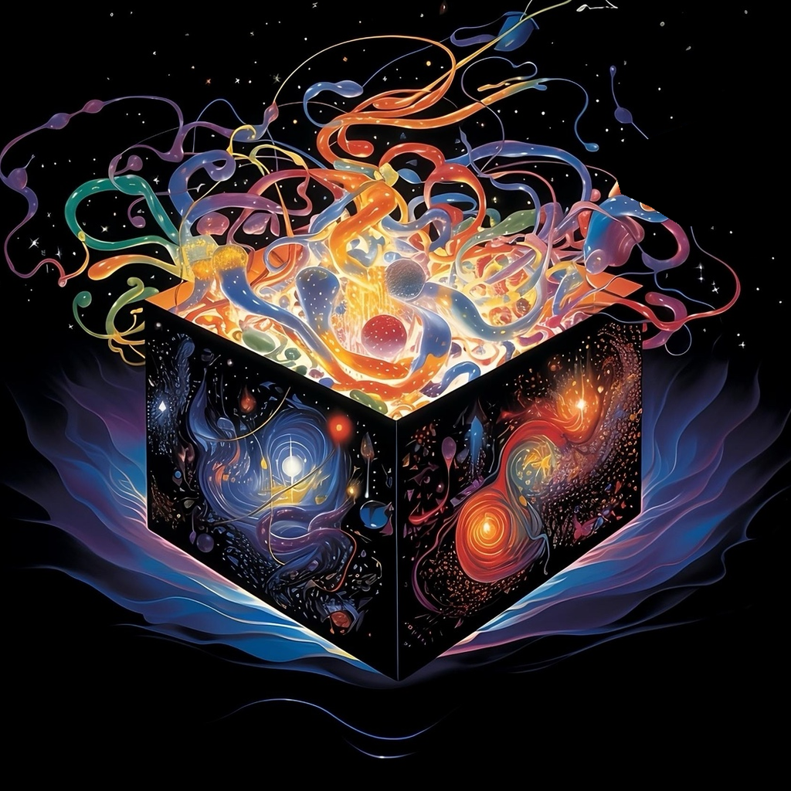
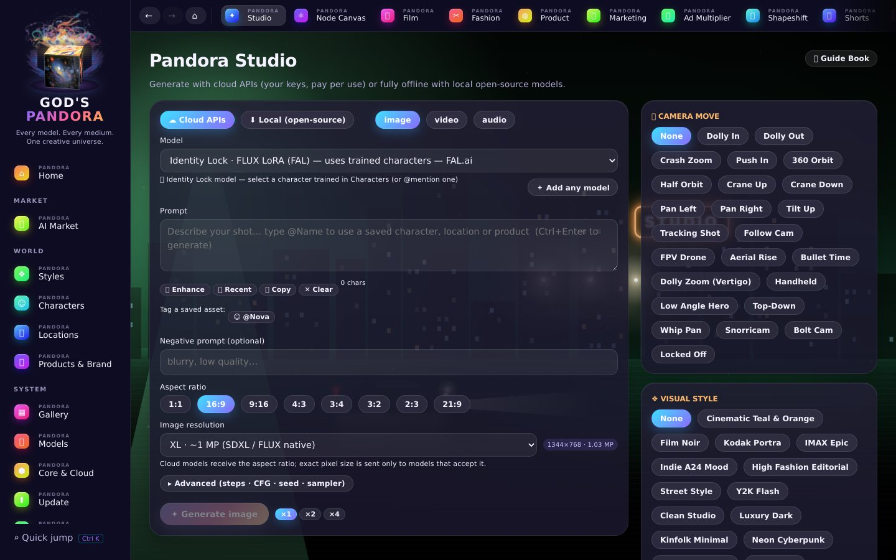
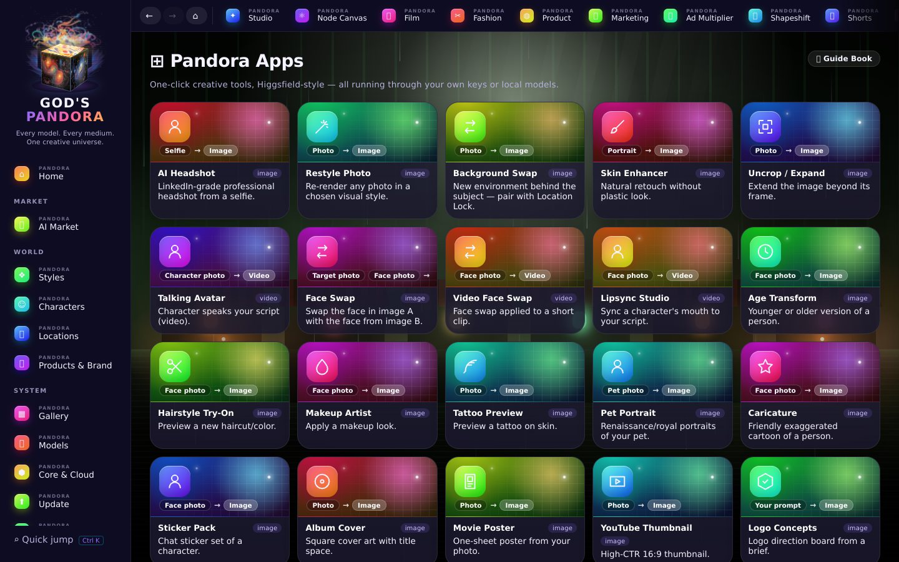
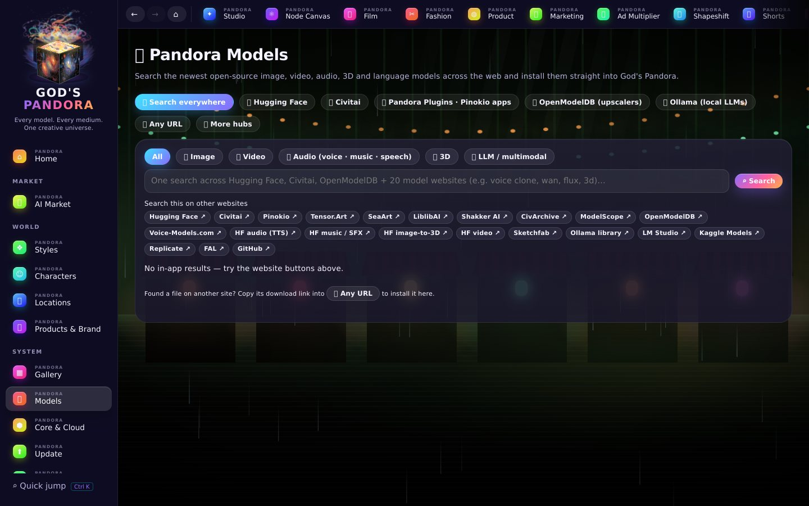
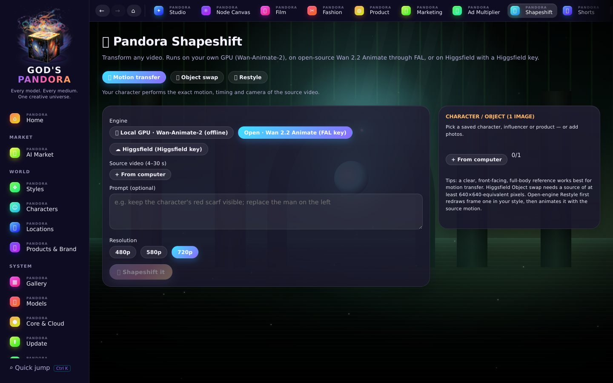
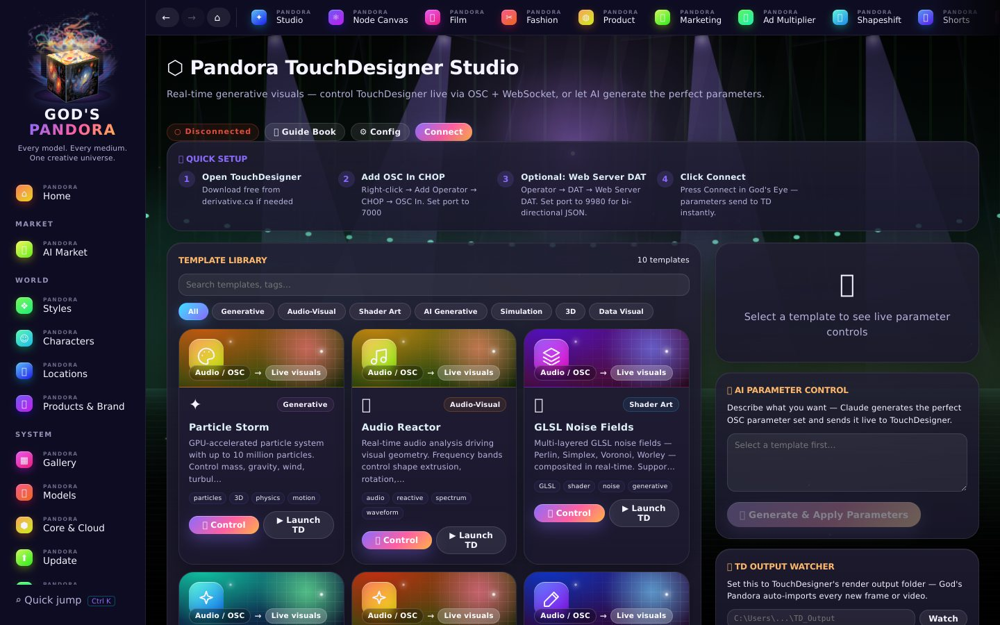

<div align="center">



# GOD'S PANDORA

### Every model. Every medium. One creative universe.

**Cloud model APIs + local open-source models — image, video, audio, 3D and TouchDesigner in one desktop app**

| | |
|---|---|
| **God's Pandora** | the main platform |
| **Pandora Core** | the open-source core (MIT) and local engine |
| **Pandora Cloud** | cloud / API services on your own keys |
| **Pandora Models** | model library and market |
| **Pandora Studio** | the creative workspace |
| **Pandora Plugins** | extensions (Pinokio one-click apps) |
| **Pandora Gallery** | your creations |

[](LICENSE)
[](../../releases)
[](../../releases)
[](../../releases/latest)
[](../../actions)

[**⬇ Download for Windows**](../../releases/latest) · [**⬇ Download for macOS**](../../releases/latest) · [Report a bug](../../issues) · [Request a feature](../../issues)

</div>

<p align="center"></p>

---

## What is God's Pandora?

God's Pandora is a desktop AI creative studio that combines two approaches in one app:

- **Cloud mode** — Connect your own API keys (FAL.ai, Replicate, OpenAI, Google, ElevenLabs, Stability AI) and generate images, video, and audio with frontier models. You pay providers directly — no middleman markup.
- **Local mode** — Download open-source models (SDXL, FLUX Schnell, SD 1.5, Civitai checkpoints & LoRAs, any Hugging Face diffusers repo) and run them offline on your own GPU.
- **🛒 Model Market** — one search across Hugging Face, Civitai, OpenModelDB, Ollama and Pinokio (185+ one-click AI apps for music, voice, sound, video and 3D), plus quick search on 20+ other model sites.

Signature feature: **⌖ Location Lock** — save a virtual location once, and every generation stays in that environment. Combine it with **🧬 Identity Lock** (trained faces) and Product Lock for consistent characters, places and products in one shot.

---

## A look inside

| | |
|---|---|
|  **Pandora Studio** — any image, video or audio model, cloud or local |  **Pandora Apps** — 41 one-click tools, each with its own visual card |
|  **Film Studio** — 40 film styles, 70 cameras, 70 lenses |  **Pandora Models** — Hugging Face, Civitai, Pinokio, Ollama in one search |
|  **Shapeshift** — motion transfer, swap, restyle any video |  **TouchDesigner** — live AI visuals over OSC / WebSocket |

Every page has its own cinematic night scene — fog, practical lamps, neon, city lights and cars — and the
living Pandora box revolves on the home screen.

---

## Studios

| Studio | What it does |
|--------|-------------|
| **✦ Create** | Image, video & audio generation with camera presets, character lock, and location lock |
| **🎬 Film Studio** | Multi-shot projects — 40 film styles, 70 cameras, 70 lenses, 12 grain looks, 130 director styles, 30 palettes |
| **✂ Fashion Studio** | Outfit Swap, Lookbook, Colorway, Fabric Macro, Runway Video, Flat Lay — 30 tools, 20 styles, 53 poses |
| **◍ Product Designer** | 21 tools: Packshot, Lifestyle, Ad Creative, 360 Turntable, Exploded View, Billboard, and more |
| **⊞ Apps** | 41 one-click apps: Headshot, Face Swap, Background Swap, Lipsync, Age Transform, Stickers, Album Cover, and more |
| **⚒ App Forge** | Describe an app — Claude builds it as a live, runnable single-file app with instant preview |
| **📣 Marketing** | URL to Ad, UGC ads, 3-second hooks, TikTok-native, A/B ad batches |
| **📱 Shorts** | Talking-head shorts with Bold Urban, Green Contrast, Warm Glow presets |
| **🎓 Explainer** | Topic → captioned explainer: pixel art, claymotion, papercraft, whiteboard, mixed media |
| **🌟 AI Influencer** | Permanent virtual personas with locked identity across posts, reels, outfits, and brand collabs |
| **🎙 Voice & Audio** | Voiceover, character voices, sound design, music beds via ElevenLabs/FAL or local MusicGen/Bark |
| **⚛ Node Canvas** | Drag-and-drop node editor chaining any cloud + local models in one pipeline |
| **🧊 3D & Spatial** | Text / image → 3D, Gaussian splats, NeRF capture — 22 tools, cloud and open-source |
| **⬡ TouchDesigner** | Real-time generative visuals controlled over OSC + WebSocket, 10 templates, AI-written parameters |
| **📈 Ad Multiplier** | Rebuild a winning video ad with your own product, cast and location |
| **🌀 Shapeshift** | Motion transfer, object swap and restyle for any video |

---

## Unique features

### ⌖ Location Lock
Save a virtual location once (reference images + description). Every generation reproduces that exact environment. Chain it with **Character Lock** (trained face consistency) for full scene consistency.

### ☺ Character Lock
Attach reference images + a description to any character. Reuse the same face, outfit, and identity across every image and video.

### ⚒ App Forge
Describe any app, game, or tool → God's Pandora calls Claude to build it as a self-contained HTML/JS app → preview it live → save it to your shelf.

### 💰 You own your API keys
Your keys go directly from your machine to the provider. God's Pandora never sees your prompts, images, or billing.

---

## Installation

### Option A — Download the installer (easiest)

1. Go to [**Releases**](../../releases/latest)
2. Download `Gods-Pandora-Setup-x.x.x.exe` (Windows) or `Gods-Pandora-x.x.x-arm64.dmg` (macOS)
3. Run the installer → launch from Desktop or Start Menu

> **Windows "Windows protected your PC" screen?** Click **More info → Run anyway**. Signed releases remove this once the certificate builds SmartScreen reputation — see [SIGNING.md](SIGNING.md).
> **macOS "app is damaged / can't be opened"?** The app isn't notarized yet. Drag it to Applications, then run `xattr -cr "/Applications/God's Pandora.app"` in Terminal once.

### Option B — Run from source

**Requirements:** Node.js 18+, npm

```bash
git clone https://github.com/YOUR_GITHUB_USERNAME/gods-pandora.git
cd gods-pandora
npm install
npm run dev
```

---

## First-run setup

1. Launch the app — the setup wizard runs once automatically
2. Go to **Settings** → paste your API keys (encrypted at rest via OS keychain)
3. Go to **Characters** → create consistent identities with reference images
4. Go to **Locations** → save virtual environments for Location Lock
5. Go to **Create** or any Studio → start generating

### Supported providers

| Provider | Image | Video | Audio |
|----------|-------|-------|-------|
| FAL.ai | ✓ | ✓ | ✓ |
| Replicate | ✓ | ✓ | — |
| OpenAI (DALL-E 3) | ✓ | — | ✓ (Whisper/TTS) |
| Google (Imagen) | ✓ | — | — |
| Stability AI | ✓ | — | — |
| ElevenLabs | — | — | ✓ |
| **Local (offline)** | ✓ | — | ✓ (MusicGen/Bark) |

---

## Local engine (offline mode)

Needs **Python 3.10+** on your PATH.

1. Go to **Models** tab → click **Install engine** (downloads PyTorch + diffusers into a private venv)
2. Click **Download** next to any open-source model (pulls from Hugging Face into app storage)
3. In **Create**, switch to **Local** — your downloaded models appear automatically

Realistic hardware requirements:
- SD 1.5: 4 GB VRAM (runs on almost anything)
- SDXL: 8 GB VRAM
- FLUX.2 [klein] 4B / FLUX.1 Schnell: 12–13 GB VRAM (CPU offload helps on smaller cards)

**Gated models** (Llama, FLUX.1/FLUX.2 [dev], SD 3.5…): accept the license on the model's Hugging Face page, create a token at <https://huggingface.co/settings/tokens>, and paste it in **Settings → API Keys → Hugging Face**.

Every generation panel has **resolution presets** (SD → 4 MP for images, 480p → 4K for video), aspect ratios, duration/FPS for video, and an **Advanced** drawer with steps, CFG, seed and sampler (sampler applies to the local engine).

---

## Run any model

- **Built in:** FAL, Replicate, Higgsfield, Hugging Face (hosted), OpenAI, Google, Stability, ElevenLabs and the local engine.
- **Add your own:** Models → *＋ Add any model* → pick the provider, paste the endpoint / repo id. It appears in every model picker.
- **Local engine:** image *and* video diffusers models run on your GPU. Re-run *Install / repair engine* after updating so new packages (video export) are installed.
- **Higgsfield key:** create credentials at <https://console.higgsfield.ai> and paste them as `KEY_ID:KEY_SECRET`.

## 🛒 Model Market

Sidebar → **Model Market**:

| Tab | What you get |
|-----|--------------|
| 🌍 Search everywhere | One query → live results from Hugging Face, Civitai, OpenModelDB and Pinokio, plus search buttons for Tensor.Art, SeaArt, LiblibAI, ModelScope, Voice-Models.com, Sketchfab, Ollama, LM Studio, Kaggle, Replicate, FAL, GitHub… |
| 🤗 Hugging Face | Trending / newest image, video, audio (TTS · music · speech), 3D and LLM models — one-click download |
| 🎨 Civitai | Checkpoints, LoRAs, embeddings (SFW). SD 1.5 / SDXL / Pony / Illustrious run in the local engine; LoRAs stack in Create with strength sliders + trigger words |
| 🧩 Pinokio apps | 185+ one-click AI apps: ACE-Step, YuE, DiffRhythm, Stable Audio 3, Applio/RVC, F5-TTS, XTTS, Chatterbox, MMAudio, Wan2GP… → **Install in Pinokio** |
| 🔍 OpenModelDB · 🦙 Ollama · 🔗 Any URL | Upscalers, local LLMs, and any direct model file link |

## Characters, locations, products — connected everywhere

Save an asset once, then type `@Name` in any prompt. Any result can be saved into a character, location or product (*＋ Save to…*), remixed, animated or extended. The **AI Influencer** builder creates permanent influencers from 19 menu categories (optionally with your own face).

## Skilled tools

| Tool | What it does | Runs on |
|---|---|---|
| 🧬 **Identity Lock** | Train a character's identity once, reuse it in every image | 💻 Local GPU (SDXL / SD 1.5 LoRA) · FAL (FLUX LoRA) · Higgsfield SOUL |
| 🌀 **Shapeshift** | Motion transfer · object swap · restyle any video | 💻 Local GPU (Wan-Animate-2) · FAL (Wan 2.2 Animate) · Higgsfield (cloud) |
| 📈 **Ad Multiplier** | Recreate a reference ad with your product, cast, location, hooks and CTAs | 💻 Local vision LLM (Ollama / LM Studio) or Claude + any local or cloud model |

Local requirements: Identity Lock 8–16 GB VRAM · Shapeshift ~24 GB VRAM + 64 GB RAM · Ad breakdown any vision model in Ollama (`ollama pull qwen2.5vl`).

## Updating

Open **⬆ Update** in the sidebar:

- **App updates** — *Check for updates* → *Download* → *Restart & install*. Updates come from this repo's GitHub Releases (the app also checks quietly at startup).
- **Model updates** — *Check for model updates* compares each downloaded model with its latest Hugging Face revision and offers a one-click update.
- **Newest releases** — a live feed of the latest open-source models from Black Forest Labs, Qwen, Wan, Lightricks, Tencent, Meta, DeepSeek, Google, Zhipu, Moonshot, Mistral and more, with real download size shown before you install.

**For maintainers:** run `SET-GITHUB-USER.bat` once (writes your GitHub username into `package.json`), bump `version` in `package.json`, commit, then `git tag v0.2.1 && git push --tags`. The GitHub Action builds the installers and publishes them with `latest.yml`, which is what installed copies use to update themselves.

---

## Add your own models

Edit `data/modelCatalog.json` — it's plain JSON, no code needed:

```json
{
  "id": "my-model",
  "name": "My Custom Model",
  "provider": "fal",
  "kind": "image",
  "endpoint": "fal-ai/your-endpoint-id"
}
```

---

## Build from source

```bash
# Windows installer (.exe) — or just double-click BUILD.bat
npm run build:win

# macOS disk image (.dmg) — must run on a Mac
npm run build:mac
```

Output lands in `release/`. See [BUILD.md](BUILD.md) for full details including CI, icons, and code-signing.

---

## Architecture

```
gods-pandora/
├── electron/          # Main process, IPC handlers, API providers
│   ├── main.js        # App entry, window, IPC registration
│   ├── generate.js    # Generation dispatcher
│   ├── providers/     # FAL, Replicate, OpenAI, Google, ElevenLabs, Stability, Local
│   └── engineManager.js  # Python local engine lifecycle
├── src/               # React renderer (Vite)
│   ├── App.jsx        # Navigation shell
│   ├── pages/         # One file per studio/page
│   └── lib/           # store.jsx (global state), Media.jsx
├── data/              # JSON config: models, studios, camera presets, styles
├── engine/            # Python FastAPI local inference server
└── docs/              # Architecture, roadmap, research docs
```

---

## Roadmap

See [docs/10X-ROADMAP.md](docs/10X-ROADMAP.md) for the full 23-feature plan. Top priorities:

- [ ] **Continuity Engine** — vision-model cross-shot audit against World Bible
- [ ] **Last-frame chaining** — shot N+1 starts from shot N's last frame
- [ ] **Screenplay import** — parse Fountain/PDF scripts into Film Studio shots
- [ ] **Cost router** — auto-route to cheapest provider that meets quality bar
- [ ] **Per-entity LoRA training** — overnight fine-tune on your own GPU for mathematically locked characters

---

## Contributing

Pull requests are welcome. For major changes, open an issue first.

```bash
git clone https://github.com/YOUR_GITHUB_USERNAME/gods-pandora.git
cd gods-pandora
npm install
npm run dev   # hot-reload dev mode
```

**Adding a studio tool:** edit `data/studios.json` — tools are JSON definitions, no React code needed.
**Adding a provider:** add a file in `electron/providers/` following the existing pattern.

---

## License

[MIT](LICENSE) — free to use, modify, and distribute.

---

<div align="center">
Made by <a href="https://github.com/YOUR_GITHUB_USERNAME">Haider Bhatti</a>
<br><br>
<sub>God's Pandora is not affiliated with any AI provider. You are responsible for complying with each provider's terms of service.</sub>
</div>
