<p align="center"><a href="https://github.com/MarkuBhatti/Gods-Pandora/releases/latest">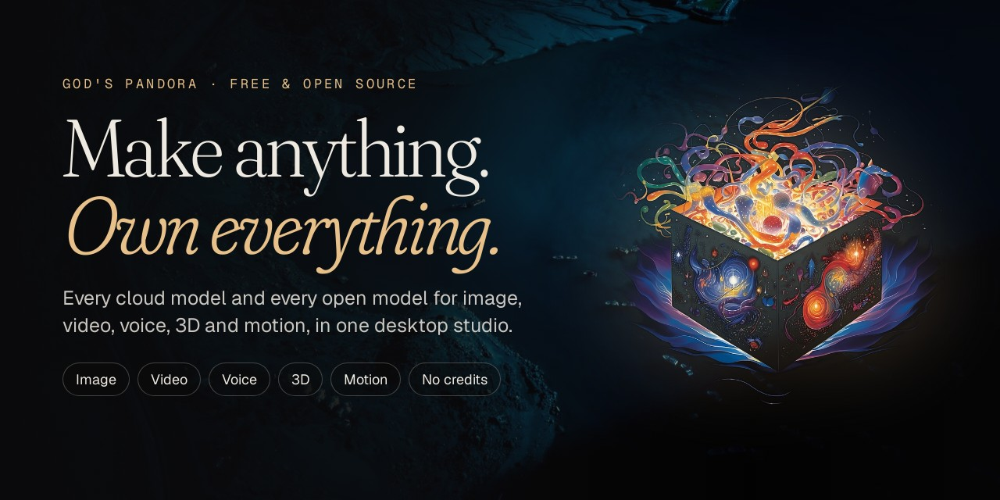</a></p>

<h1 align="center">God's Pandora</h1>

<p align="center"><b>Every model. Every medium. One creative universe.</b><br>
A free, open-source AI creative studio for Windows: image, video, voice, 3D and motion.<br>
Bring your own cloud keys, or run open-source models free on your own GPU. No credits, no markup.</p>

<p align="center">
<a href="https://github.com/MarkuBhatti/Gods-Pandora/releases/latest"></a>
<a href="https://github.com/MarkuBhatti/Gods-Pandora/releases"></a>
<a href="LICENSE"></a>

</p>

<p align="center"><a href="https://github.com/MarkuBhatti/Gods-Pandora/releases/latest"><b>⬇ Download for Windows</b></a> · <a href="https://github.com/MarkuBhatti/Gods-Pandora/issues">Report a bug</a> · <a href="https://github.com/MarkuBhatti/Gods-Pandora/issues">Request a feature</a></p>

<p align="center">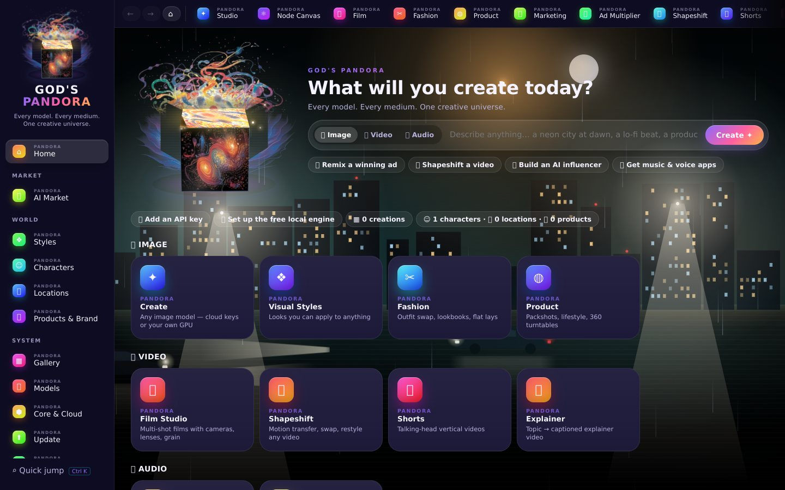</p>

---

## Why God's Pandora?

- **Every model in one app.** Frontier cloud models (FAL, Replicate, OpenAI, Google, ElevenLabs, Stability, Higgsfield, Hugging Face) next to open models running offline on your GPU.
- **You own everything.** Your keys go straight from your PC to the provider. No credits, no subscription, nothing expires. Your files stay on your machine.
- **Download & run, no terminal.** Search Hugging Face and Civitai, press one button, and the model appears in your studio.
- **One idea, end to end.** One brief becomes stills, motion, voice and a finished, graded cut.

## What you can do

| | What you can do |
|---|---|
| **🎨 Create** | **Image & video** from one prompt with any model · **Film** studio (shot-by-shot storyboards, 70 cameras, 70 lenses, 130 director styles) · **Photo** studio · **Voice & music** (voice-overs, dialogue, songs, sound effects) · **3D** (text or image → 3D model) · **Phone Camera** (your phone as a Blender camera) · **TouchDesigner** live visuals |
| **✂ Edit** | **AutoEdit** cuts your footage to the beat · **Color** auto-grades and matches shots · **Photo Retouch** · **51 Effects** with an AI subject mask · **Motion Design** (kinetic titles, logo reveals, ad remakes) · **Shapeshift** (motion transfer, character swap, restyle) |
| **📣 Campaigns** | **Marketing** (URL → ad, UGC, hooks) · **Ad Multiplier** (one ad → many variants) · **AI Influencer** · **Fashion** (virtual try-on, lookbooks) · **Product** shots · **Shorts** & **Explainers** |
| **🧱 Build** | **Apps** (41 one-click tools like headshots, face swap, lipsync) · **App Forge** (describe an app and Claude builds it) · design docs & digital products |
| **🌍 World** | **Identity Lock · Location Lock · Product Lock** keep the same face, place and product in every image and video |
| **🔌 Connect** | **Pandora Agent** plans a whole job and uses every tool · **Claude / Cursor / ChatGPT** can drive Pandora over MCP · works inside **Blender, DaVinci Resolve and Premiere Pro** |
| **🔓 Own it** | 1,000+ cloud models on **your own keys** (FAL, Replicate, OpenAI, Google, ElevenLabs, Stability, Higgsfield…) or **open models free on your GPU** · one-click **Model Market** (Hugging Face, Civitai) · **no credits, no markup**, files stay on your PC |

## Highlights

<table>
<tr>
<td width="50%">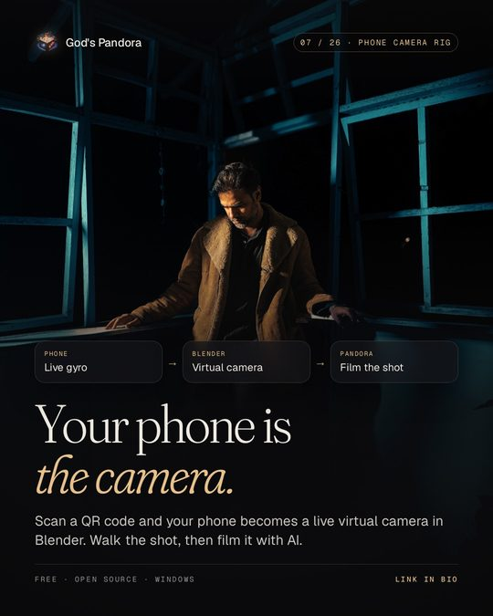<br><b>📱 Your phone is the camera</b><br>Scan a QR code and your phone becomes a live handheld camera in Blender. Walk the shot, then <b>Blocking → Film</b> turns the grey blocking into the finished scene.</td>
<td width="50%">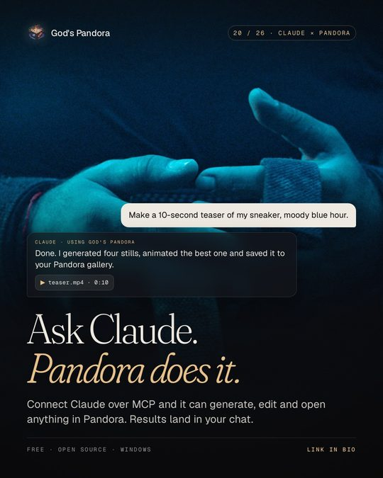<br><b>🤖 Ask Claude, Pandora does it</b><br>Connect Claude (or Cursor, VS Code…) over MCP and it can generate, edit, grade and open anything in Pandora. Results land right in the chat and in your Gallery.</td>
</tr>
<tr>
<td>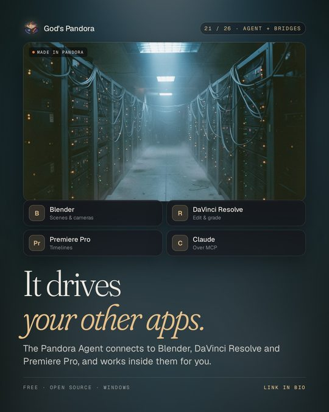<br><b>🔗 It drives your other apps</b><br>The Pandora Agent connects to Blender, DaVinci Resolve and Premiere Pro through MCP and works inside them in the same job.</td>
<td>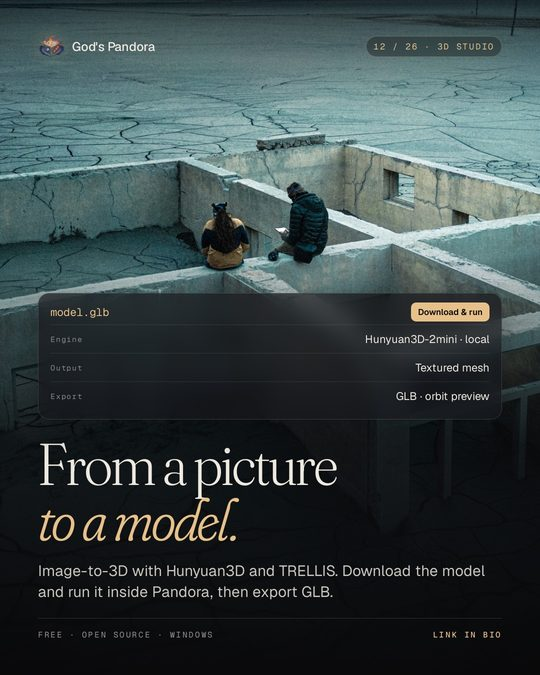<br><b>🧊 From a picture to a model</b><br>Text or image → textured GLB with Hunyuan3D-2 mini or Shap-E on your GPU, or Hunyuan3D v2 / TRELLIS in the cloud. Built-in 3D viewer.</td>
</tr>
<tr>
<td>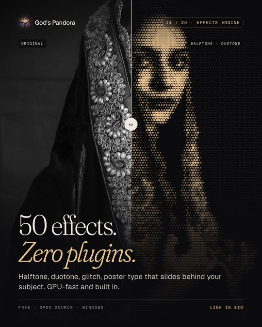<br><b>✨ 51 effects, zero plugins</b><br>GPU-rendered halftone, duotone, glitch, glass, light and poster type that slides behind your subject (offline AI subject mask). Layers, templates, video export.</td>
<td>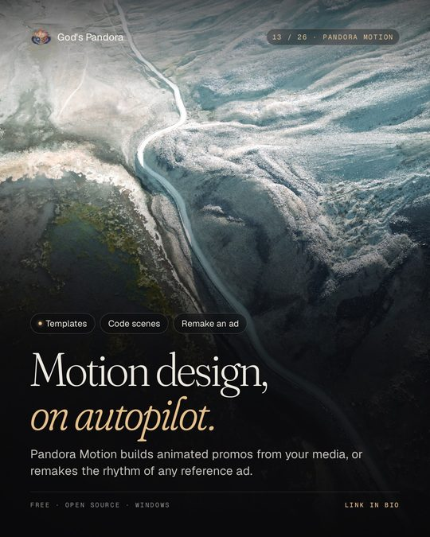<br><b>🎞 Motion design on autopilot</b><br>Pandora Motion builds animated promos from your media, writes code scenes, or remakes the rhythm of any reference ad with your brief.</td>
</tr>
<tr>
<td>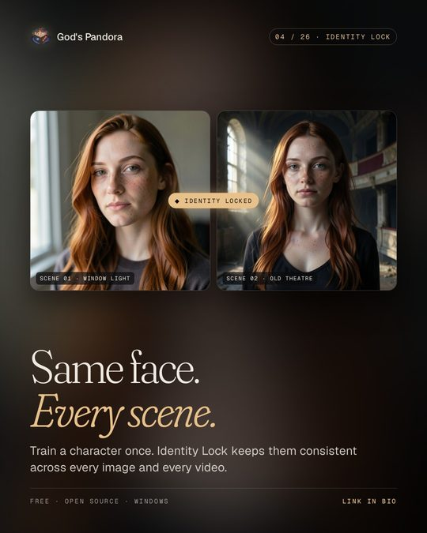<br><b>🧬 Same face, every scene</b><br>Identity Lock, Location Lock and Product Lock keep characters, places and products consistent across every image and video.</td>
<td>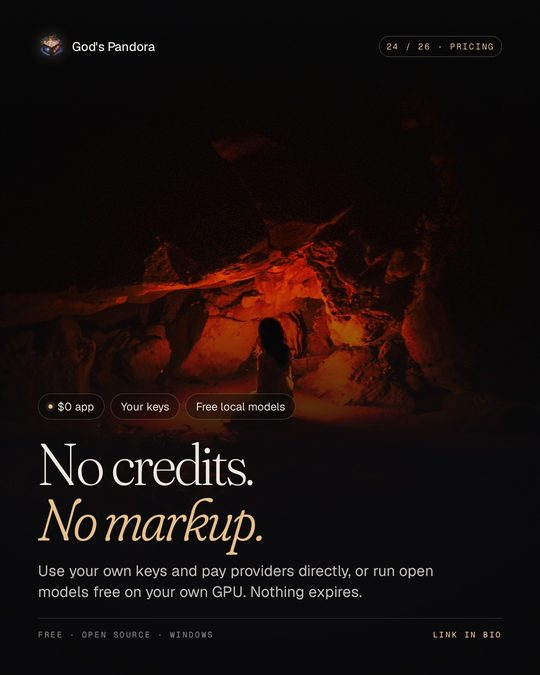<br><b>💸 No credits, no markup</b><br>Pay providers directly with your own keys, or run open models free on your own GPU. Keys are encrypted on-device.</td>
</tr>
</table>

## A look inside

| | |
|---|---|
| 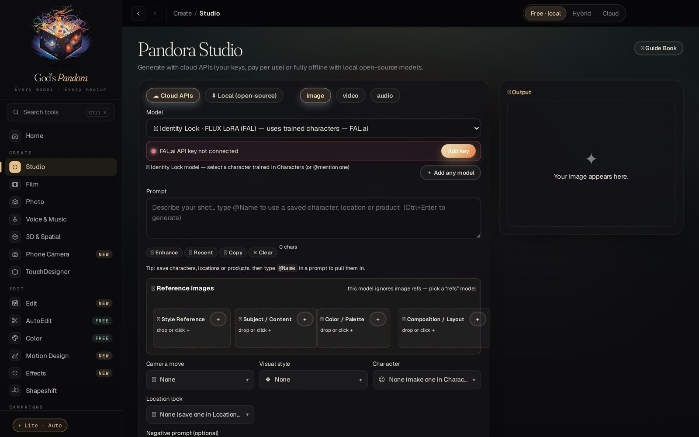<br>**Pandora Studio:** any image, video or audio model, cloud or local | 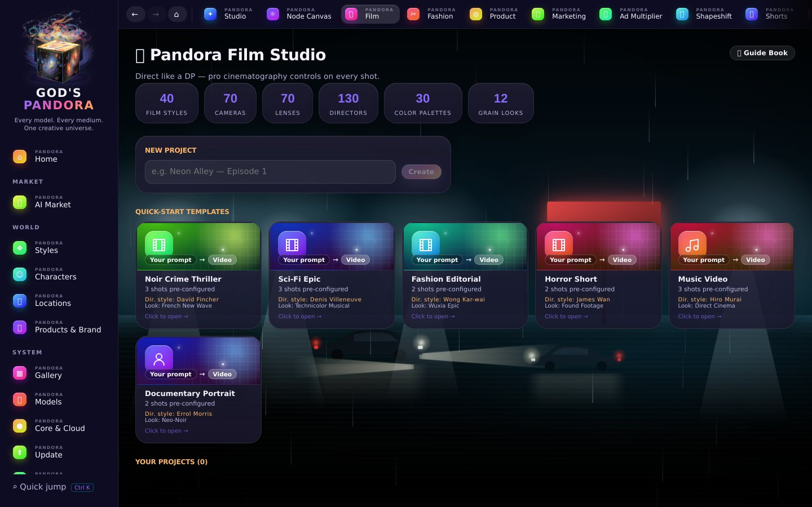<br>**Film:** shot-by-shot storyboards, 70 cameras, 70 lenses, 130 director styles |
| 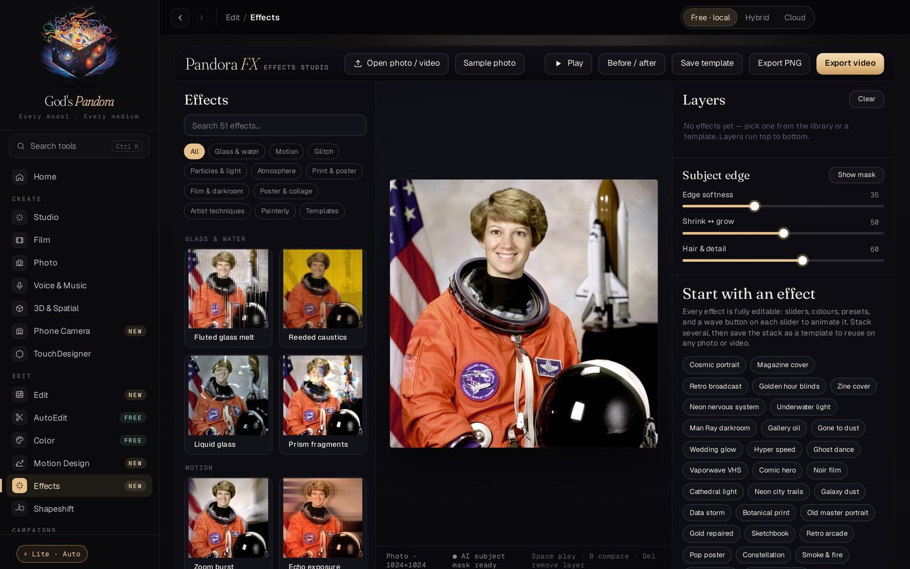<br>**Effects:** 51 real-time looks with an AI subject mask | 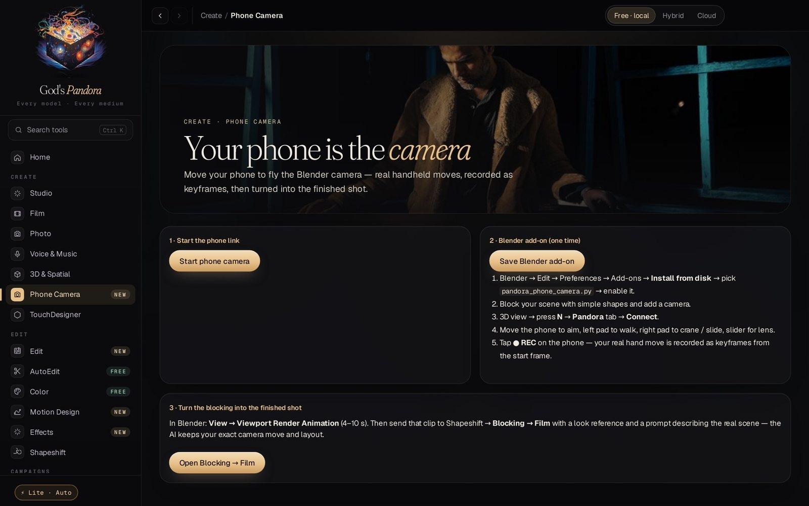<br>**Phone Camera:** your phone as a Blender camera |
| 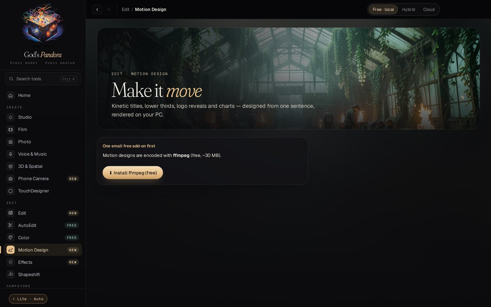<br>**Motion Design:** kinetic titles, logo reveals and remakes | 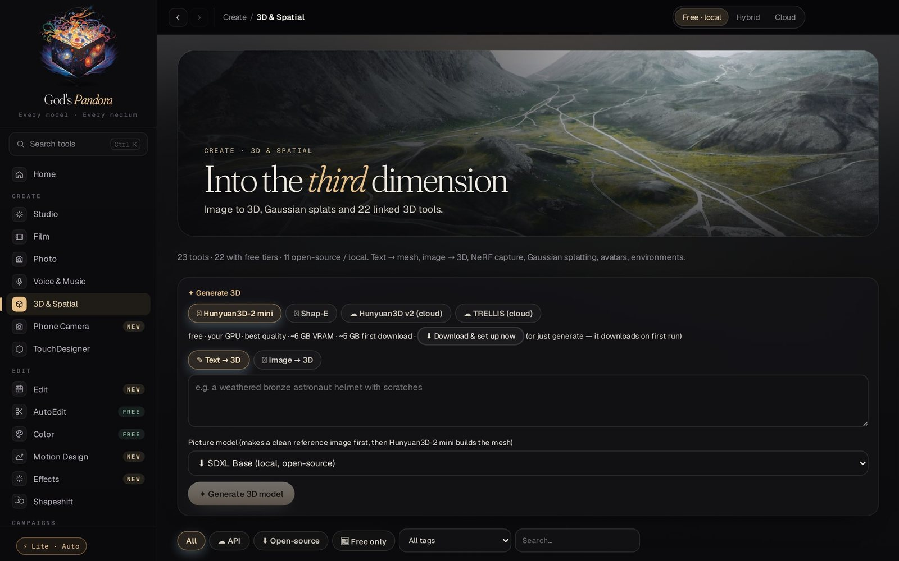<br>**3D & Spatial:** text / image → 3D, splats, 22 tools |
| 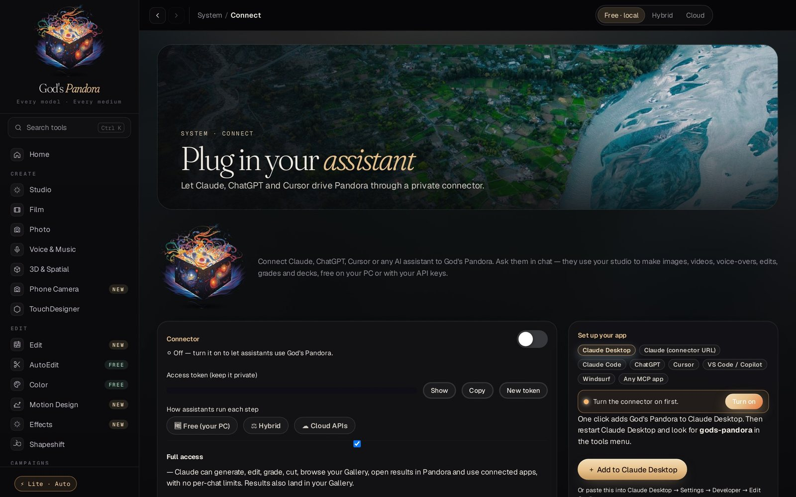<br>**Connect:** plug Claude, Cursor or ChatGPT into Pandora | |

---

## Studios

| Studio | What it does |
|--------|-------------|
| **✦ Create** | Image, video & audio generation with camera presets, character lock, and location lock |
| **🎬 Film Studio** | Multi-shot projects — 40 film styles, 70 cameras, 70 lenses, 12 grain looks, 130 director styles, 30 palettes |
| **✂ Fashion Studio** | Outfit Swap, Lookbook, Colorway, Fabric Macro, Runway Video, Flat Lay — 30 tools, 20 styles, 53 poses |
| **◍ Product Designer** | 21 tools: Packshot, Lifestyle, Ad Creative, 360 Turntable, Exploded View, Billboard, and more |
| **⊞ Apps** | 41 one-click apps: Headshot, Face Swap, Background Swap, Lipsync, Age Transform, Stickers, Album Cover, and more |
| **⚒ App Forge** | Describe an app — Claude builds it as a live, runnable single-file app with instant preview |
| **📣 Marketing** | URL to Ad, UGC ads, 3-second hooks, TikTok-native, A/B ad batches |
| **📱 Shorts** | Talking-head shorts with Bold Urban, Green Contrast, Warm Glow presets |
| **🎓 Explainer** | Topic → captioned explainer: pixel art, claymotion, papercraft, whiteboard, mixed media |
| **🌟 AI Influencer** | Permanent virtual personas with locked identity across posts, reels, outfits, and brand collabs |
| **🎙 Voice & Audio** | Voiceover, character voices, sound design, music beds via ElevenLabs/FAL or local MusicGen/Bark |
| **⚛ Node Canvas** | Drag-and-drop node editor chaining any cloud + local models in one pipeline |
| **🧊 3D & Spatial** | Text / image → 3D, Gaussian splats, NeRF capture — 22 tools, cloud and open-source |
| **⬡ TouchDesigner** | Real-time generative visuals controlled over OSC + WebSocket, 10 templates, AI-written parameters |
| **📈 Ad Multiplier** | Rebuild a winning video ad with your own product, cast and location |
| **🎞 Pandora Cut** | Auto edit to the beat (beat + scene detection, smart reframe, transitions) and auto colour grading (Auto Balance, Shot Match, film looks, .cube LUTs) — free, offline, ffmpeg |
| **🌀 Shapeshift** | Motion transfer, object swap and restyle for any video |

---

## Unique features

### ⌖ Location Lock · 🧬 Identity Lock · 📦 Product Lock
Save a place, a face or a product once. Every generation reproduces it exactly, and the three locks combine in one shot.

### 🤖 Claude full access (MCP)
Pandora runs a private, token-protected connector on 127.0.0.1. Claude can generate, edit, auto-edit, grade, browse your Gallery and drive connected apps, with results shown in its own chat.

### 📱 Phone Camera → Blender → Film
Your phone's motion sensors drive a Blender camera live over Wi-Fi; REC records the real hand move as keyframes.

### ⚒ App Forge
Describe any app, game or tool. Pandora asks Claude to build it as a self-contained app, previews it live and saves it to your shelf.

### 💰 You own your API keys
Your keys go directly from your machine to the provider. God's Pandora never sees your prompts, images or billing.

---

## Installation

### Option A — Download the installer (easiest)

1. Go to [**Releases**](../../releases/latest)
2. Download `Gods-Pandora-Setup-x.x.x.exe` (Windows 10/11, 64-bit)
3. Run the installer → launch from Desktop or Start Menu

> **Windows "Windows protected your PC" screen?** Click **More info → Run anyway**. Signed releases remove this once the certificate builds SmartScreen reputation — see [SIGNING.md](SIGNING.md).

### Option B — Run from source

**Requirements:** Node.js 18+, npm

```bash
git clone https://github.com/MarkuBhatti/Gods-Pandora.git
cd Gods-Pandora
npm install
npm run dev
```

---

## First-run setup

1. Launch the app — the setup wizard runs once automatically
2. Go to **Settings** → paste your API keys (encrypted at rest via OS keychain)
3. Go to **Characters** → create consistent identities with reference images
4. Go to **Locations** → save virtual environments for Location Lock
5. Go to **Create** or any Studio → start generating

### Supported providers

| Provider | Image | Video | Audio |
|----------|-------|-------|-------|
| FAL.ai | ✓ | ✓ | ✓ |
| Replicate | ✓ | ✓ | — |
| OpenAI (DALL-E 3) | ✓ | — | ✓ (Whisper/TTS) |
| Google (Imagen) | ✓ | — | — |
| Stability AI | ✓ | — | — |
| ElevenLabs | — | — | ✓ |
| **Local (offline)** | ✓ | — | ✓ (MusicGen/Bark) |

---

## Local engine (offline mode)

Needs **Python 3.10+** on your PATH.

1. Go to **Models** tab → click **Install engine** (downloads PyTorch + diffusers into a private venv)
2. Click **Download** next to any open-source model (pulls from Hugging Face into app storage)
3. In **Create**, switch to **Local** — your downloaded models appear automatically

Realistic hardware requirements:
- SD 1.5: 4 GB VRAM (runs on almost anything)
- SDXL: 8 GB VRAM
- FLUX.2 [klein] 4B / FLUX.1 Schnell: 12–13 GB VRAM (CPU offload helps on smaller cards)

**Gated models** (Llama, FLUX.1/FLUX.2 [dev], SD 3.5…): accept the license on the model's Hugging Face page, create a token at <https://huggingface.co/settings/tokens>, and paste it in **Settings → API Keys → Hugging Face**.

Every generation panel has **resolution presets** (SD → 4 MP for images, 480p → 4K for video), aspect ratios, duration/FPS for video, and an **Advanced** drawer with steps, CFG, seed and sampler (sampler applies to the local engine).

---

## Run any model

- **Built in:** FAL, Replicate, Higgsfield, Hugging Face (hosted), OpenAI, Google, Stability, ElevenLabs and the local engine.
- **Add your own:** Models → *＋ Add any model* → pick the provider, paste the endpoint / repo id. It appears in every model picker.
- **Local engine:** image *and* video diffusers models run on your GPU. Re-run *Install / repair engine* after updating so new packages (video export) are installed.
- **Higgsfield key:** create credentials at <https://console.higgsfield.ai> and paste them as `KEY_ID:KEY_SECRET`.

## 🛒 Model Market

Sidebar → **Model Market**:

| Tab | What you get |
|-----|--------------|
| 🌍 Search everywhere | One query → live results from Hugging Face, Civitai, OpenModelDB and Pinokio, plus search buttons for Tensor.Art, SeaArt, LiblibAI, ModelScope, Voice-Models.com, Sketchfab, Ollama, LM Studio, Kaggle, Replicate, FAL, GitHub… |
| 🤗 Hugging Face | Trending / newest image, video, audio (TTS · music · speech), 3D and LLM models — one-click download |
| 🎨 Civitai | Checkpoints, LoRAs, embeddings (SFW). SD 1.5 / SDXL / Pony / Illustrious run in the local engine; LoRAs stack in Create with strength sliders + trigger words |
| 🧩 Pinokio apps | 185+ one-click AI apps: ACE-Step, YuE, DiffRhythm, Stable Audio 3, Applio/RVC, F5-TTS, XTTS, Chatterbox, MMAudio, Wan2GP… → **Install in Pinokio** |
| 🔍 OpenModelDB · 🦙 Ollama · 🔗 Any URL | Upscalers, local LLMs, and any direct model file link |

## Characters, locations, products — connected everywhere

Save an asset once, then type `@Name` in any prompt. Any result can be saved into a character, location or product (*＋ Save to…*), remixed, animated or extended. The **AI Influencer** builder creates permanent influencers from 19 menu categories (optionally with your own face).

## Skilled tools

| Tool | What it does | Runs on |
|---|---|---|
| 🧬 **Identity Lock** | Train a character's identity once, reuse it in every image | 💻 Local GPU (SDXL / SD 1.5 LoRA) · FAL (FLUX LoRA) · Higgsfield SOUL |
| 🌀 **Shapeshift** | Motion transfer · object swap · restyle any video | 💻 Local GPU (Wan-Animate-2) · FAL (Wan 2.2 Animate) · Higgsfield (cloud) |
| 📈 **Ad Multiplier** | Recreate a reference ad with your product, cast, location, hooks and CTAs | 💻 Local vision LLM (Ollama / LM Studio) or Claude + any local or cloud model |

Local requirements: Identity Lock 8–16 GB VRAM · Shapeshift ~24 GB VRAM + 64 GB RAM · Ad breakdown any vision model in Ollama (`ollama pull qwen2.5vl`).

## Updating

Open **⬆ Update** in the sidebar:

- **App updates** — *Check for updates* → *Download* → *Restart & install*. Updates come from this repo's GitHub Releases (the app also checks quietly at startup).
- **Model updates** — *Check for model updates* compares each downloaded model with its latest Hugging Face revision and offers a one-click update.
- **Newest releases** — a live feed of the latest open-source models from Black Forest Labs, Qwen, Wan, Lightricks, Tencent, Meta, DeepSeek, Google, Zhipu, Moonshot, Mistral and more, with real download size shown before you install.

**For maintainers:** run `SET-GITHUB-USER.bat` once (writes your GitHub username into `package.json`), bump `version` in `package.json`, commit, then `git tag v0.2.1 && git push --tags`. The GitHub Action builds the installers and publishes them with `latest.yml`, which is what installed copies use to update themselves.

---

## Add your own models

Edit `data/modelCatalog.json` — it's plain JSON, no code needed:

```json
{
  "id": "my-model",
  "name": "My Custom Model",
  "provider": "fal",
  "kind": "image",
  "endpoint": "fal-ai/your-endpoint-id"
}
```

---

## Build from source

```bash
# Windows installer (.exe) — or just double-click BUILD.bat
npm run build:win

# macOS disk image (.dmg) — must run on a Mac
npm run build:mac
```

Output lands in `release/`. See [BUILD.md](BUILD.md) for full details including CI, icons, and code-signing.

---

## Architecture

```
Gods-Pandora/
├── electron/          # Main process, IPC handlers, API providers
│   ├── main.js        # App entry, window, IPC registration
│   ├── generate.js    # Generation dispatcher
│   ├── providers/     # FAL, Replicate, OpenAI, Google, ElevenLabs, Stability, Local
│   └── engineManager.js  # Python local engine lifecycle
├── src/               # React renderer (Vite)
│   ├── App.jsx        # Navigation shell
│   ├── pages/         # One file per studio/page
│   └── lib/           # store.jsx (global state), Media.jsx
├── data/              # JSON config: models, studios, camera presets, styles
├── engine/            # Python FastAPI local inference server
└── docs/              # Architecture, roadmap, research docs
```

---

## Roadmap

See [docs/10X-ROADMAP.md](docs/10X-ROADMAP.md) for the full 23-feature plan. Top priorities:

- [ ] **Continuity Engine** — vision-model cross-shot audit against World Bible
- [ ] **Last-frame chaining** — shot N+1 starts from shot N's last frame
- [ ] **Screenplay import** — parse Fountain/PDF scripts into Film Studio shots
- [ ] **Cost router** — auto-route to cheapest provider that meets quality bar
- [ ] **Per-entity LoRA training** — overnight fine-tune on your own GPU for mathematically locked characters

---

## Contributing

Pull requests are welcome. For major changes, open an issue first.

```bash
git clone https://github.com/MarkuBhatti/Gods-Pandora.git
cd Gods-Pandora
npm install
npm run dev   # hot-reload dev mode
```

**Adding a studio tool:** edit `data/studios.json` — tools are JSON definitions, no React code needed.
**Adding a provider:** add a file in `electron/providers/` following the existing pattern.

---

## License

[MIT](LICENSE) — free to use, modify, and distribute.

---

<div align="center">
Made by <a href="https://github.com/MarkuBhatti">Haider Bhatti</a>
<br><br>
<sub>God's Pandora is not affiliated with any AI provider. You are responsible for complying with each provider's terms of service.</sub>
</div>
